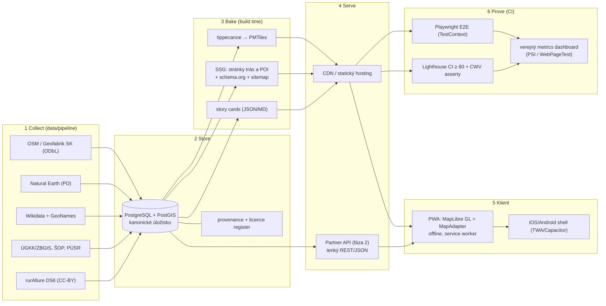

# Architektúra systému SATS-SEO-GIS

Dokument patrí do `docs/architecture/ARCHITECTURE.md`. Vychádza z partner briefingu (október 2026) a z aktuálneho stavu repozitára (Vite + MapLibre GL JS, Playwright, Lighthouse CI).

## 1. Princíp

**Static-first.** Všetko, čo sa dá vypočítať vopred (stránky trás a POI, vektorové dlaždice, sitemap), sa vygeneruje pri builde a servíruje z CDN. Server za behu je potrebný len pre Partner API a registrovaných používateľov, a to až vo fáze 2. Dôvod: SEO (crawlovateľné stránky), Core Web Vitals (LCP ≤ 2,5 s, INP ≤ 200 ms, CLS ≤ 0,1) a takmer nulové náklady na infraštruktúru.

## 2. Vrstvy (collect → store → bake → serve → prove)

## 3. Komponenty a zodpovednosti

| Vrstva | Adresár | Zodpovednosť | Technológia |
|---|---|---|---|
| Collect + ETL | `data/pipeline/` | Stiahnutie, validácia, import do PostGIS, zápis do licence registra | Python, osm2pgsql |
| Store | `data/db/` | Schéma, migrácie, seed; kanonické úložisko | PostgreSQL + PostGIS |
| Bake | `data/bake/` | Export PMTiles (tippecanoe), generovanie JSON pre SSG | tippecanoe, Python/Node |
| Frontend | `app/` | Stránky trás/POI (SSG), mapa ako „island“, PWA, offline | Astro (ADR-0001) alebo Vite, MapLibre GL JS |
| API | `backend/` | Partner API, používatelia, moderácia trás (fáza 2) | Go alebo PHP (rozhodnúť v ADR) |
| Prove | `app/tests/`, `.github/workflows/` | E2E, Lighthouse CI, nočný zber metrík | Playwright, LHCI, GitHub Actions |
| Dokumentácia | `docs/` | ADR, architektúra, zápisnice, plánovanie | Markdown, LaTeX pre odovzdanie |

## 4. Kľúčové návrhové rozhodnutia

1. **Mapa sa načíta až po interakcii.** Už to máš v prototype. Dôvod je LCP: MapLibre je ťažký, takže prvý render musí byť statický obsah alebo náhľadový obrázok.
2. **Dve cesty k obsahu.** Crawler dostane hotové HTML stránky trás a POI (schema.org `TouristAttraction`, `Place`). Človek dostane tú istú stránku obohatenú o interaktívnu mapu. Toto je hlavný odlišovač projektu.
3. **`MapAdapter` ako šev.** Aplikácia nikdy nevolá MapLibre priamo, ale cez rozhranie (`init`, `addLayer`, `flyTo`, `onMove`). Leaflet fallback alebo native shell sa potom dá vymeniť bez zásahu do stránok (SOLID, ADR-0003).
4. **`TestContext` pre testy.** Jedna Playwright sada s parametrizovaným kontextom (web PWA / mobilný shell), aby sa testy neduplikovali.
5. **Licencie oddelene.** OSM-odvodené dlaždice sú ODbL (share-alike), dáta partnerov patria do samostatných tabuliek API. Nikdy sa nemiešajú do PMTiles.
6. **Veľké dáta mimo gitu.** Geofabrik PBF (346 MB) a ďalšie surové dáta patria do `data/raw/` v `.gitignore`. Verzujú sa len skripty, `data/SOURCES.md` a SHA256 súčty.

## 5. Odporúčaný postup (v poradí)

1. Reorganizovať repozitár (skript `restructure.sh`) a opraviť cesty v CI.
2. Rozhodnúť frontend: Vite SPA nevie vyrobiť crawlovateľné stránky bez pred-renderu. Odporúčam **Astro** (SSG + MapLibre island), ako je v ADR-0001. Zapísať do `docs/adr/0001-frontend.md`.
3. PostGIS cez `docker-compose.yml` + import SK extraktu cez osm2pgsql.
4. Export PMTiles a načítanie v MapLibre cez `pmtiles` protokol.
5. Generovanie stránok trás/POI + `sitemap.xml` + schema.org.
6. Lighthouse CI a CWV asserty ako podmienka merge.
7. Metrics dashboard (PSI API, nočný cron).
8. Partner API a účty až po stabilnom v1.

## 6. Čo zatiaľ vedome nerobíme

- Natívne iOS/Android aplikácie (len TWA/Capacitor shell nad rovnakým kódom).
- Vlastný routing engine (OSRM/Valhalla až po v1).
- Kompletné všetkých 70+ kategórií POI naraz. Začať s Active tourism a Heritage.
