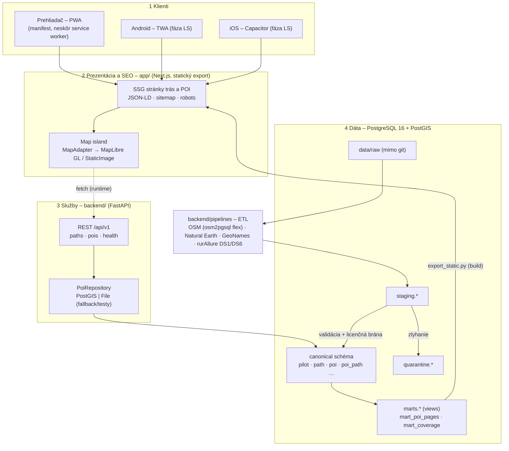
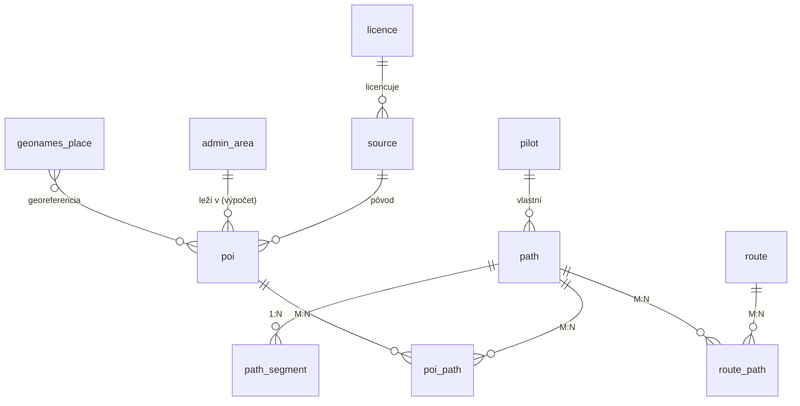

# Architektúra systému SATS-SEO-GIS

*Verzia 0.2 · šprint 1-1Z · nahrádza pôvodný návrh (Astro/Vite/Go), ktorý padol rozhodnutím ADR-0001.*

Dokument opisuje **cieľovú architektúru** podľa zadania (kap. 4, 5, 6 dokumentácie) a **čo z nej existuje
po šprinte 1**. Kde sa líšime od šablóny dokumentácie (Astro, Node API, Rust edge), je to zapísané v ADR.

## 1. Princípy

1. **Static-first.** Čo sa dá vypočítať vopred (stránky trás a POI, sitemap, dlaždice), sa vygeneruje pri builde
   a servíruje staticky. Dôvod: SEO, Core Web Vitals (LCP ≤ 2,5 s, INP ≤ 200 ms, CLS ≤ 0,1), nulové náklady.
2. **Jedna databáza pravdy.** PostgreSQL 16 + PostGIS 3 je kanonické úložisko (key-locations DB).
   Frontend ani API nevlastnia dáta – len ich čítajú.
3. **Proveniencia od narodenia.** Každý riadok nesie `source_id` + `licence_id` (KPI K10, US-11).
   Riadok bez licencie neprejde zo `staging` do `canonical` (licenčná brána).
4. **Švy (SOLID).** UI volá `MapAdapter`, nie MapLibre; API volá `PoiRepository`, nie SQL priamo.
   Testy dostanú falošné implementácie (`FakeMapAdapter`, `FilePoiRepository`).
5. **Kvalita ako brána.** Lint, unit, E2E a Lighthouse bežia v CI; červená = žiadny merge.

## 2. Vrstvy (4-vrstvová architektúra zo zadania)



**Dva toky dát:**

- **Build-time (hlavný, SEO):** `canonical → marts → export_static.py → app/public/data/*.json → next build → out/`.
  Crawler dostane hotové HTML bez potreby API.
- **Runtime (doplnkový):** mapa a neskôr quiz/check-in volajú `GET /api/v1/...` (napr. POI v okolí bodu).

## 3. Komponenty, adresáre, technológie

| # | Modul (kap. 5) | Adresár | Technológia | Stav po 1-1Z |
|---|---|---|---|---|
| 1 | Mapa a vektorové dlaždice | `app/src/lib/map/` | MapLibre GL JS za `MapAdapter`, PMTiles (ADR-0003) | adapter + static fallback; PMTiles v 3-3Z |
| 2 | POI a dátová služba | `backend/`, `data/db/` | FastAPI, PostGIS 16, psycopg 3 (ADR-0004) | schéma, ETL, API kostra |
| 3 | Trasy a príbehy | `data/seed/paths.json` → DB | kurátorské JSON + DB | 7 trás so zastávkami |
| 6 | SEO, SSG, štruktúrované dáta | `app/src/app/` | Next.js 15 `output: 'export'` (ADR-0001) | stránky trás + vrcholov, sitemap |
| 7 | Metriky | `.github/workflows/nightly-metrics.yml` | LHCI, PSI (neskôr) | nočné LHCI |
| 8 | CI/CD a brány | `.github/workflows/` | GitHub Actions | lint + unit + E2E + LHCI |
| 4, 5 | Learning/quiz, AI | – | – | letný semester |

## 4. Repozitár (monorepo)

```
sats-seo-gis/
├── app/                      # Next.js – web + PWA shell (localhost:3000)
│   └── src/
│       ├── app/              # routy: /, /trasy/, /trasy/[slug]/, /vrcholy/[slug]/
│       ├── components/
│       └── lib/
│           ├── map/          # MapAdapter, MapLibreAdapter, StaticImageAdapter, FakeMapAdapter
│           └── paths.ts      # načítanie trás pri builde
├── backend/
│   ├── app/                  # FastAPI (localhost:8000, /docs = OpenAPI)
│   │   ├── api/v1/           # routery: health, paths, pois
│   │   └── repositories/     # PoiRepository: PostGIS + File
│   ├── pipelines/            # ETL skripty (python -m pipelines.<krok>)
│   └── tests/                # pytest
├── data/
│   ├── db/migrations/        # SQL schéma (číslované, idempotentné)
│   ├── db/checks.sql         # dátové kontrakty
│   ├── osm/flex.lua          # osm2pgsql flex štýl
│   ├── seed/paths.json       # 7 trás + zastávky (kurátorské)
│   ├── fixtures/             # malé vzorky DS1/DS6 pre testy a lokálny beh
│   ├── raw/ processed/       # surové a medzivýsledky – mimo git
│   └── SOURCES.md            # odkazy + SHA256 stiahnutých súborov
├── docs/ adr/ architecture/ methodology/ minutes/ planning/
├── docker-compose.yml        # db (PostGIS) + api
├── Makefile                  # make db, make data, make api, make dev …
└── .env.example
```

## 5. Dátový model (canonical, šprint 1 – doména „geografia a trasy“)



| Tabuľka | Účel |
|---|---|
| `licence`, `source` | register licencií a zdrojov (US-11); každý dátový riadok na ne odkazuje |
| `pilot`, `path`, `path_segment` | piloty A/B/C, 7 tematických trás, geometria segmentov |
| `poi`, `poi_path` | kanonický POI model (tier T1–T3, quality score), väzba na trasu s `role` a `detour_km` |
| `route`, `route_path` | OSM `route=*` relácie a ich zdieľanie trás |
| `admin_area`, `geonames_place` | Natural Earth hranice/kraje, GeoNames sídla (georeferencie, vyhľadávanie) |
| `staging.*` | surové riadky podľa zdroja (OSM, DS1, DS6, NE, GeoNames) – na diff a replay |
| `quarantine.rejected_row` | čo neprešlo validáciou, s dôvodom |
| `marts.mart_poi_pages`, `marts.mart_coverage` | pohľady pre SSG export a KPI K10 |

Zvyšok 22 tabuliek zo zadania (quiz, check_in, score_event, consent_log, offline_op_log, metric_run…)
pribudne v šprintoch, ktoré ich potrebujú – migrácie sú číslované, takže sa len pridajú.

## 6. ETL pipeline (medallion: raw → staging → canonical → marts)

| Krok | Skript | Vstup | Výstup |
|---|---|---|---|
| Extract | `pipelines.fetch` | URL zo `data/SOURCES.md` | `data/raw/*` + SHA256 |
| OSM ingest | `pipelines.load_osm` (osm2pgsql flex) | `slovakia-latest.osm.pbf` | `staging.osm_poi`, `staging.osm_route` |
| Natural Earth | `pipelines.load_natural_earth` | NE admin-0/1 GeoJSON | `canonical.admin_area` |
| GeoNames | `pipelines.load_geonames` | `SK.zip` (TSV) | `canonical.geonames_place` |
| rurAllure DS1 | `pipelines.load_rurallure --ds1` | CSV/XLSX POI | `staging.rurallure_ds1` |
| rurAllure DS6 | `pipelines.load_rurallure --ds6` | GPX/GeoJSON trasy | `staging.rurallure_ds6` |
| Seed trás | `pipelines.seed_paths` | `data/seed/paths.json` | `pilot`, `path`, `poi`, `poi_path` |
| Promote | `pipelines.promote` | `staging.*` | `canonical.poi` / `quarantine` (licenčná brána) |
| Export | `pipelines.export_static` | `marts.*` | `app/public/data/*.json` |

Orchestrácia: v ZS `make data` (sekvencia krokov), Airflow DAG-y podľa kap. 6 až keď beží server (ADR-0005).

## 7. Nasadenie

- **Lokálne (teraz):** `docker compose up -d db` → `make data` → `make api` (8000) + `npm run dev` (3000).
  Bez Dockeru beží API aj frontend nad súbormi (`REPOSITORY=file`), takže kostra ide spustiť hneď.
- **Cieľ (ZS):** statický `out/` na CDN/statickom hostingu, API + PostGIS v Dockeri na fakultnej VM
  `teamNN-26.studenti.fiit.stuba.sk`.

## 8. Rozdiely voči šablóne dokumentácie

| Šablóna | My | ADR |
|---|---|---|
| Astro SSG + islands | Next.js 15 statický export + klientske komponenty | 0001 |
| API v Node / Rust (axum) | Python 3.12 + FastAPI (jeden jazyk s ETL) | 0004 |
| Airflow od začiatku | Makefile + Python skripty, Airflow neskôr | 0005 |
| Expo/RN mobil (príloha Z-B) | PWA + TWA + Capacitor nad tým istým buildom | 0002 |

## 9. Čo vedome nerobíme v ZS

Natívne aplikácie, vlastný routing engine, edge vrstva (Varnish/Caddy PoP), všetkých 70+ kategórií POI naraz.
